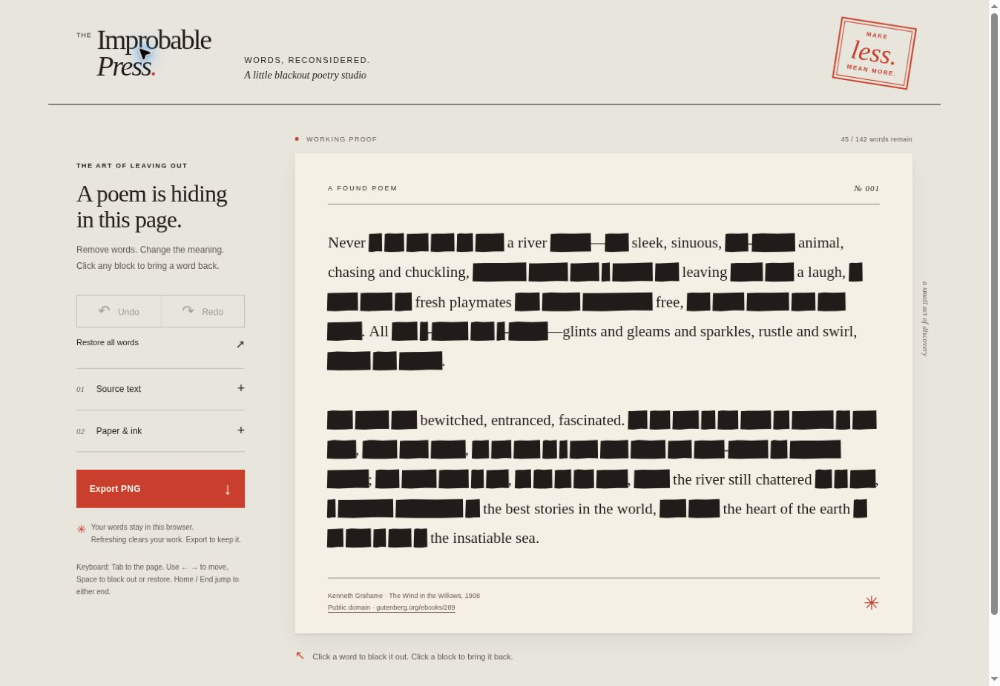

# The Improbable Press

A focused blackout-poetry maker. Paste text or load a UTF-8 `.txt` file, choose individual word occurrences to black out, then save a PNG of the finished page.



## Run locally

From the repository root, serve the static app:

```sh
python3 -m http.server 8000 --directory dist
```

Open <http://localhost:8000>. The app has no runtime or npm dependencies and no build step; `dist/` is the complete site.

## Use

Paste text or choose a UTF-8 `.txt` file. Inputs are limited to 12,000 characters; files are also limited to 60,000 bytes. Punctuation, paragraph breaks, and verse lines are retained, and repeated words can be selected independently. Use the appearance controls to change the page, Undo/Redo to move through edits, and Restore all words to reveal the current source. Source replacement and restoring all words are part of the undo history.

The poem and edit history live only in the current page session. Refreshing clears the work. PNG export follows the current page layout and measures rendered browser geometry. It scales the output from 1× to 2× within 32 million pixels and a maximum edge of 16,384 pixels. Pages exceeding those limits at 1× stop with an actionable message.

The sample source is *The Wind in the Willows* by Kenneth Grahame (1908), via [Project Gutenberg, ebook 289](https://www.gutenberg.org/ebooks/289).

## Checks

The checks passed with Node.js v24.19.0. Run:

```sh
npm test
npm run check
```

For optional manual width checks, copy `test/viewport.html` to `dist/viewport-check.html` while the local server above is running, then open `http://localhost:8000/viewport-check.html`. Its buttons resize the same app iframe to 1280px or 390px. Remove the temporary copy afterwards; it is not part of the deployed app. No CI workflow is configured.

See [browser evidence and limits](docs/browser-checks.md) and the [independent review](docs/review.md).
